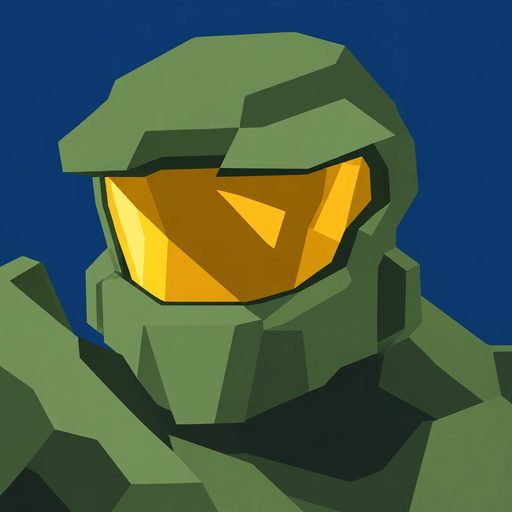

# SilentCartographer - Halo: Combat Evolved, ported to Windows, Linux and Android.


<p align="center">
  
</p>

<p align="center">
  <a href="https://github.com/GuvenHuso/SilentCartographer/releases/latest"></a>
  <a href="https://discord.gg/jAaYaXtvyK"></a>
</p>

SilentCartographer runs the original Xbox Halo: Combat Evolved on a PC,
a Steam Deck or an Android phone, from your own copy of the game. It is
built on a decompilation of the Xbox game (build 01.01.14.2342,
`cachebeta.exe`, SHA-256
`4cc87b45f721270392a96f1674ed2b5cd4a7bb4355faeab4531d1cf1884d9520`): the
game's own code, compiled for each platform, with a new layer that stands in
for the Xbox.


SilentCartographer is a fork of [OpenCE](https://github.com/OpenCommunityEdition/OpenCE),
released under the GNU Affero General Public License, version 3 or later,
as OpenCE is. It follows OpenCE's latest code and adds its own changes on
top, so it has OpenCE's features as they come out. **It plays network
games with OpenCE**: players of either can join each other's games.

## Download

Each build of the `main` branch that passes on every platform becomes a
release, and is announced on the Discord. These links always give the
latest one:

| Platform | Release (to play) | Debug (to report problems) |
| --- | --- | --- |
| Windows | [halo-windows-release.zip](https://github.com/GuvenHuso/SilentCartographer/releases/latest/download/halo-windows-release.zip) | [halo-windows-debug.zip](https://github.com/GuvenHuso/SilentCartographer/releases/latest/download/halo-windows-debug.zip) |
| Linux | [halo-linux-release.zip](https://github.com/GuvenHuso/SilentCartographer/releases/latest/download/halo-linux-release.zip) | [halo-linux-debug.zip](https://github.com/GuvenHuso/SilentCartographer/releases/latest/download/halo-linux-debug.zip) |
| Android | [halo-android-release.zip](https://github.com/GuvenHuso/SilentCartographer/releases/latest/download/halo-android-release.zip) | [halo-android-debug.zip](https://github.com/GuvenHuso/SilentCartographer/releases/latest/download/halo-android-debug.zip) |

- **Release** builds are for playing.
- **Debug** builds stop at the first problem they find and write it to the
  log. Use one to report a problem.
- **Questions, problems, or people to play with:** join the
  [SilentCartographer Discord](https://discord.gg/jAaYaXtvyK).
- **The game updates itself.** At start-up it looks for a newer release and
  asks whether to install it. Refer to "Updates" in
  [port/linux/README.md](port/linux/README.md#updates).
- **Older builds:** the [Releases](https://github.com/GuvenHuso/SilentCartographer/releases)
  page keeps the last five. If the latest build has a problem, get an
  earlier one there.
- **Checking a download:** each release has `SHA256SUMS`, the SHA-256 of
  each of its files; `sha256sum -c --ignore-missing SHA256SUMS` checks them.
  The releases are not signed yet (they have no `SHA256SUMS.sig`):
  [deploy/release-key.pub](deploy/release-key.pub) is OpenCE's key, which
  checks OpenCE's releases only.

## A legal copy of the game is required

**SilentCartographer does not include Halo, and never will.** The downloads
hold only SilentCartographer's own program. Halo's maps, sounds, textures
and everything else of the game come from **your own copy** of Halo: Combat
Evolved for the original Xbox.

- **Use a disc you own.** Make an image (`.iso` or `.xiso`) of your own
  Halo: Combat Evolved disc. Every version of the game works, from any
  region.
- **Do not download the game, and do not share it.** This project does not
  help anyone get Halo without owning it. Please do not ask for, link to or
  post game files anywhere in this project.
- **Custom Edition maps** also need `bitmaps.map`, `sounds.map` and
  `loc.map` from your own installation of Halo Custom Edition (refer to
  "Custom Edition maps", below).

### Setting up the game

1. Start SilentCartographer (`halo.exe` on Windows, `halo` on Linux).
2. At the first start it asks for your disc image. Select it.
3. It copies the `maps/` folder out of the image, then the game starts.
   Nothing is uploaded anywhere.

On Windows and Linux, `maps/` goes next to the program. On Android, copy
the disc image to the phone first; the app keeps `maps/` in its own data
folder (refer to [port/android/README.md](port/android/README.md)). The
`maps/` folder is for the Xbox maps only: if it holds Halo PC's maps
instead, the game says so and stops. The maps of the European (PAL) version
were made for a slower console: SilentCartographer plays them as the North
American (NTSC) maps play, so players of both versions can play together.

## Features

**The game, on your devices**

- Windows, Linux (the Steam Deck too) and Android, from one code base.
- One frame for each refresh of your display (Smooth Motion), not the
  Xbox's 30, with the game's own 30 ticks a second kept for everything
  else.
- Any resolution and aspect ratio, and a field of view of your choice.
- The Xbox's look by default, with more in the video settings: anti-aliasing
  (FXAA, SMAA, MSAA, SSAA), anisotropic filtering, sharper shadows,
  per-pixel lighting, HDR, your own legs in first person, and more.
- A high-resolution HUD redrawn by hand, sharp text at any resolution, and
  the menus of Halo Custom Edition for PC.
- Keyboard and mouse, gamepads, and on Android touch controls with
  gyroscope aiming.
- Split screen: the Xbox's two-player co-op campaign on one computer, and
  up to 4 players on each computer in network games.

**Multiplayer**

- System link on your local network, with up to 128 players on up to 128
  machines, and Windows, Linux and Android playing together, and with
  OpenCE's players.
- Internet play with invite links and a server browser, and invites sent
  through Discord. No game server is needed: one player hosts. A dedicated
  server (`halo --server`) is there too (refer to
  [docs/dedicated_server.md](docs/dedicated_server.md)).
- A new netcode: each machine moves its own player at once, and the host
  decides for the game (refer to [port/linux/NETCODE.md](port/linux/NETCODE.md)).
- New gametypes: SWAT, Infection, Gun Game and Hardcore, and bots for local
  multiplayer games.
- Voice chat, text chat, a scoreboard that scrolls for large games, and
  kicking and banning players, or votes to kick.
- Map sharing: players who join without a Custom Edition map download it
  from the others.
- Streamer mode, which hides slurs, swearing and insults in what other
  players write.

**Online co-op campaign**

- The campaign with friends over the internet.
- Server Setup's Co-op Options: friendly fire between players, whether the
  players can hurt their AI allies, extra enemies that grow with the
  players, and player collisions.

**Custom content**

- Halo Custom Edition maps, played as Custom Edition plays them.
- Mods: folders of Halo PC tag files (texture, sound, text and model
  packs) that play over the maps on your own machine. The main menu's Mods
  turns them on and off and sets their order (refer to
  [docs/mods.md](docs/mods.md)).

Every setting, and the controls, are in
[port/linux/README.md](port/linux/README.md). They are almost the same on
every platform. The settings are in `config.toml` next to the game, and
many are in the menus too.

## Custom Edition maps

There are two ways to play Halo Custom Edition maps:

- **Copy them in.** Put the maps in the `custom_maps` folder, beside
  `maps`, with `bitmaps.map`, `sounds.map` and `loc.map` from your Halo
  Custom Edition install.
- **Or point the game at your install.** In `config.toml`, under
  `[paths]`, set `custom_edition` to the folder of your Halo Custom Edition
  install (the folder that holds its `maps` folder, not `maps` itself), in
  single quotes:

  ```toml
  [paths]
  custom_edition = 'C:\Program Files (x86)\Microsoft Games\Halo Custom Edition'
  ```

The maps then show up as CUSTOM SINGLEPLAYER and CUSTOM MULTIPLAYER in the
map lists. Halo PC's extra maps (Ice Fields, Death Island, Danger Canyon,
Infinity, Timberland and Gephyrophobia) are not in the Xbox game: copy them
from your Custom Edition install's `maps` folder too, or point the game at
the install. Maps that need OpenSauce cannot be played. Refer to
[docs/custom_edition_caches.md](docs/custom_edition_caches.md).

## Platform guides and building

| Platform | Guide |
| --- | --- |
| Windows (32-bit x86, OpenGL 4.5, SDL3) | [port/windows/README.md](port/windows/README.md) |
| Linux and the Steam Deck (32-bit x86, OpenGL 4.5, SDL3) | [port/linux/README.md](port/linux/README.md) |
| Android (arm64 app, OpenGL ES 3, SDL3) | [port/android/README.md](port/android/README.md) |

To build SilentCartographer from its source, and for its tests,
optimisation profiles and profiling builds, refer to
[docs/building.md](docs/building.md). The Xbox SDK is not needed.

## Credits

SilentCartographer stands on the work of many people.

- **Halo: Combat Evolved** is by Bungie, published by Microsoft.
- **The decompilation** is the work of
  [punpckhdq/halo](https://github.com/punpckhdq/halo) and of
  [bnunu/halo-1](https://github.com/bnunu/halo-1), which OpenCE started
  from.
- **The port** is OpenCE's. Its main contributors are Jonas Volman (bnunu)
  and MrBruh, and everyone who has contributed is on its
  [contributors page](https://github.com/OpenCommunityEdition/OpenCE/graphs/contributors).
- **SilentCartographer** is maintained by Guven
  ([GuvenHuso](https://github.com/GuvenHuso)).
- **Art:** the controller buttons by saulob; the high-resolution HUD by
  MrBruh, from reference photos by Aerocatia; the menus' mouse cursor by
  pugzysixtyfour; icons from [Lucide](https://lucide.dev). Refer to
  [AUTHORS.md](AUTHORS.md).
- **Fonts:** [Overpass](https://overpassfont.org/) (Red Hat, Delve
  Withrington), and OpenCE, made from Newtown by Roger White (refer to
  [port/assets/fonts/README.md](port/assets/fonts/README.md)).
- **Libraries:** SDL 3, Expat, jsmn, KCP, Mbed TLS, MiniUPnPc, Monocypher,
  musl (its maths functions), Opus, SMAA, stb, stb_vorbis, tomlc17 and
  zlib; and for streamer mode, Surge AI's list of profanity and dwyl's
  English words. Each is in `port/third_party`, with its licence.

## Licence

SilentCartographer is free software: you can give it to others and change
it under the terms of the GNU Affero General Public License as published by
the Free Software Foundation, version 3 of the License or (at your option)
any later version (`AGPL-3.0-or-later`). It comes with no warranty. The full
text is in [LICENSE](LICENSE).

- **Its history.** SilentCartographer is OpenCE's code with its own changes
  on top, under OpenCE's licence. OpenCE's code from before 19 October 2026,
  and the releases built from it, were released under
  [CC0 1.0](LICENSES/CC0-1.0.txt) and stay that way. From 28 October 2026
  SilentCartographer was briefly released under `GPL-3.0-or-later`, built
  on that CC0 code; its releases of then stay so, and that history is on the
  `gpl-main-backup` branch. Its own changes of that time are its
  maintainer's, under the AGPL here too.
- **What OpenCE builds on.** The decompilation of
  [punpckhdq/halo](https://github.com/punpckhdq/halo) is under the AGPL 3.0
  from 17 October 2026, and under CC0 1.0 before that date.
  [bnunu/halo-1](https://github.com/bnunu/halo-1) is under CC0 1.0.
- **Contributions** are under `AGPL-3.0-or-later`. A change taken from a
  project under GPL 3.0 keeps that licence and its notices; the GPL 3.0 and
  the AGPL 3.0 let the two be combined (section 13 of each).
- **Hosts and servers.** If you change the game and let other people play
  with your version over a network (for example, as the host of an internet
  game, or on a dedicated server), the AGPL asks you to offer them the
  source of your version (section 13). The game as released has its source
  here, and each release's source is its tag (`build-<n>`).
- **Third-party code, fonts and art** keep their own licences, which are
  next to them (`port/third_party`, `port/assets/fonts`,
  `port/assets/icons`, `port/assets/text_filter`). The release downloads
  carry their notices.
- **Halo is not covered.** The licence covers the work of SilentCartographer's
  and OpenCE's authors. It gives no rights in Halo, its maps or anything else
  that Microsoft owns.

## Disclaimer

SilentCartographer is an unofficial fan project, built on OpenCE (Open
Community Edition). It is not made, endorsed or supported by Microsoft, Xbox
Game Studios, Halo Studios, Activision or Bungie, and it is not affiliated
with them. Halo and Halo: Combat Evolved are trademarks of Microsoft
Corporation; the game and its content are © Microsoft Corporation.

SilentCartographer includes no game data. You need your own legal copy of
Halo: Combat Evolved for the original Xbox to play. The software is
provided as it is, without warranty of any kind (refer to [LICENSE](LICENSE)).
